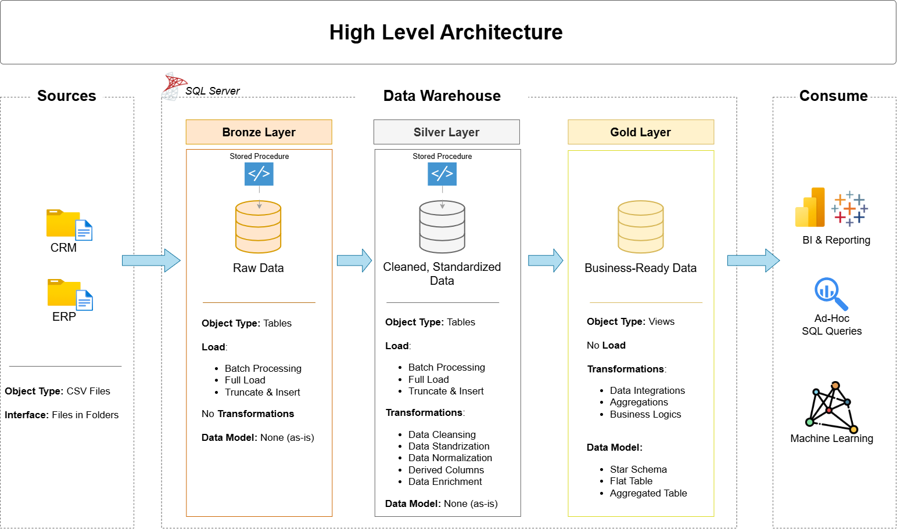

# Data Warehouse and Analytics Project

​Welcome to the **Data Warehouse and Analytics Project** repository!🚀
This project demonstrates a comprehensive data warehousing and analytics solution, from building a data warehouse to generating actionable insights. Designed as a portfolio project, it highlights industry best practices in data engineering and analytics.

You take raw files from two systems, a CRM and an ERP, and build one data warehouse in SQL Server. At the end, the data is clean and ready for analysis.

```
sql-data-warehouse-project/
├── datasets/               the six source files the project loads
│   ├── source_crm/         three files from the CRM system
│   └── source_erp/         three files from the ERP system
├── docs/                   the requirements, and the diagrams
├── scripts/                the project scripts, in the order of the layers (bronze,silver,gold)
│   ├── init_database.sql   creates the database: run it first
│   ├── bronze/             loads the raw files
│   ├── silver/             cleans and prepares the data
│   └── gold/               builds the tables for analysis
└── tests/                  checks the quality of the silver and gold data
```
---
## 🏗️ Data Architecture

The data architecture for this project follows Medallion Architecture **Bronze**, **Silver**, and **Gold** layers:


1. **Bronze Layer**: Stores raw data as-is from the source systems. Data is ingested from CSV Files into SQL Server Database.
2. **Silver Layer**: This layer includes data cleansing, standardization, and normalization processes to prepare data for analysis.
3. **Gold Layer**: Houses business-ready data modeled into a star schema required for reporting and analytics.
---
## 📖 Project Overview

In this project, you:

1. **Design the architecture:** a modern data warehouse with three layers, bronze, silver and gold.
2. **Build the ETL pipelines:** load the source files and move the data through the layers.
3. **Model the data:** facts and dimensions, ready for reports.
4. **Analyze it:** answer business questions with SQL.

---

## 🚀 Project Requirements

### Building the Data Warehouse (Data Engineering)

#### Objective
Develop a modern data warehouse using SQL Server to consolidate sales data, enabling analytical reporting and informed decision-making.

#### Specifications
- **Data Sources**: Import data from two source systems (ERP and CRM) provided as CSV files.
- **Data Quality**: Cleanse and resolve data quality issues prior to analysis.
- **Integration**: Combine both sources into a single, user-friendly data model designed for analytical queries.
- **Scope**: Focus on the latest dataset only; historization of data is not required.
- **Documentation**: Provide clear documentation of the data model to support both business stakeholders and analytics teams.

---

### BI: Analytics & Reporting (Data Analytics)

#### Objective
Develop SQL-based analytics to deliver detailed insights into:
- **Customer Behavior**
- **Product Performance**
- **Sales Trends**

These insights empower stakeholders with key business metrics, enabling strategic decision-making.

---

### 🛡️License

This project is licensed under the [MIT License]. You are free to use, modify, and share this project with proper attribution.

### 🌟About Me

Hi there! I'm **Karthick**. Results-driven **Business & Data Analyst** with **4+** years in Amazon Tech Ops, serving as the primary bridge between global business stakeholders and cross-functional engineering teams to drive catalog expansion, competitor intelligence, and data-led strategic initiatives across JP, SG, AU, Far East, and MENA marketplaces.

