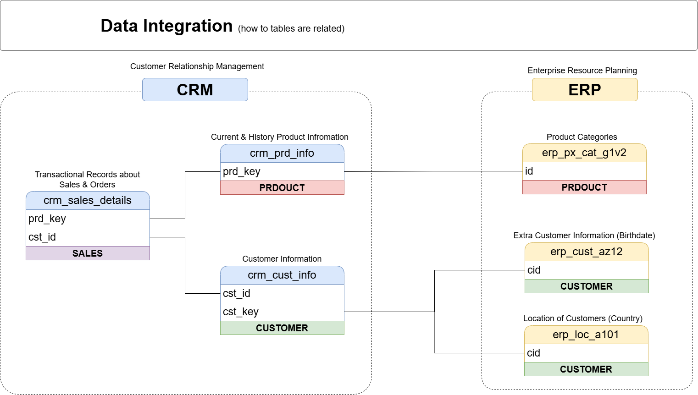
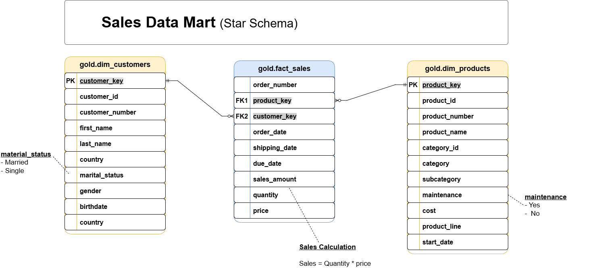
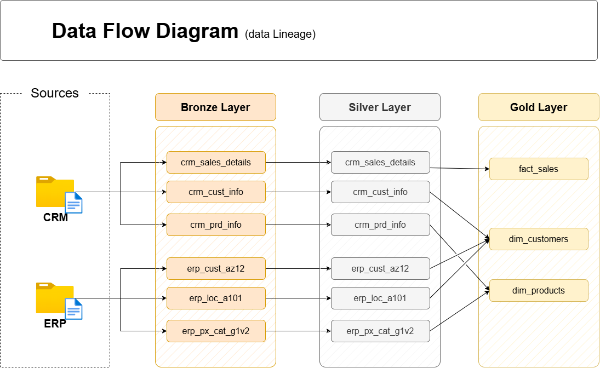

# Data Warehouse and Analytics Project

​Welcome to the **Data Warehouse and Analytics Project** repository!🚀
This project demonstrates a comprehensive data warehousing and analytics solution, from building a data warehouse to generating actionable insights. Designed as a portfolio project, it highlights industry best practices in data engineering and analytics.

You take raw files from two systems, a CRM and an ERP, and build one data warehouse in SQL Server. At the end, the data is clean and ready for analysis.

---
## 🚀 Project Requirements

### Building the Data Warehouse (Data Engineering)

#### Objective
Develop a modern data warehouse using SQL Server to consolidate sales data, enabling analytical reporting and informed decision-making.

#### Specifications
- **Data Sources**: Import data from two source systems (ERP and CRM) provided as CSV files.
- **Data Quality**: Cleanse and resolve data quality issues prior to analysis.
- **Integration**: Combine both sources into a single, user-friendly data model designed for analytical queries.
- **Scope**: Focus on the latest dataset only; historization of data is not required.
- **Documentation**: Provide clear documentation of the data model to support both business stakeholders and analytics teams.

---
## 📖 Project Overview

In this project, you:

1. **Design the architecture:** a modern data warehouse with three layers, bronze, silver and gold (**Medallion Architecture**).
2. **Build the ETL pipelines:** load the source files and move the data through the layers.
3. **Model the data:** facts and dimensions, ready for reports.
4. **Analyze it:** answer business questions with SQL.
---

```
sql-data-warehouse-project/
├── datasets/               the six source files the project loads
│   ├── source_crm/         three files from the CRM system
│   └── source_erp/         three files from the ERP system
├── docs/                   the requirements, and the diagrams
├── scripts/                the project scripts, in the order of the layers (bronze,silver,gold)
│   ├── init_database.sql   creates the database: run it first
│   ├── bronze/             loads the raw files
│   ├── silver/             cleans and prepares the data
│   └── gold/               builds the tables for analysis
└── tests/                  checks the quality of the silver and gold data
```
---

## 🏗️ Data Architecture

The data architecture for this project follows Medallion Architecture **Bronze**, **Silver**, and **Gold** layers:

1. **Bronze Layer**: Stores raw data as-is from the source systems. Data is ingested from CSV Files into SQL Server Database.
2. **Silver Layer**: This layer includes data cleansing, standardization, and normalization processes to prepare data for analysis.
3. **Gold Layer**: Houses business-ready data modeled into a star schema required for reporting and analytics.
---

## ⚙️ Tools & Services Used

- **Datasets** → Access to the project dataset (csv files).
- **SQL Server Express** → Lightweight server for hosting your SQL database.
- **SQL Server Management Studio (SSMS)** → GUI for managing and interacting with databases.
- **draw.io** → Design data architecture, models, flows, and diagrams.
- **Notion** → All-in-one tool for project management and organization and access to All Project Phases and Tasks. 
- **GitHub** →  Set up a GitHub account and repository to manage, version, and collaborate on your code efficiently.
  
---
## 🔄 Project Workflow

### 1. Requirement Analysis
- **Data Sources**: Import data from two source systems (ERP and CRM) provided as CSV files.
- **Data Quality**: Cleanse and resolve data quality issues prior to analysis.
- **Integration**: Combine both sources into a single, user-friendly data model designed for analytical queries.
- **Scope**: Focus on the latest dataset only; historization of data is not required.
- **Documentation**: Provide clear documentation of the data model to support both business stakeholders and analytics teams.
  
### 2. Designing the Data Architecture
- Builds a data warehouse with  Medallion Architecture.
    - **Bronze Layer**: Stores raw data as-is from the source systems. Data is ingested from CSV Files into SQL Server Database.
    - **Silver Layer**: This layer includes data cleansing, standardization, and normalization processes to prepare data for analysis.
    - **Gold Layer**: Houses business-ready data modeled into a star schema required for reporting and analytics.
      
*Created medallion architecture containers in **draw.io** to visualize the high level structure.*


### 3. Project Initialization
- Defining project naming conventions -> Set of rules or guidelines for naming anything in the project(eg. naming databases, and tables). Please refer it from here [Naming Conventions](docs/naming_conventions.md)
- Creating Database (DataWarehouse) & Schemas (bronze, silver, gold). Please refer it from here [Creating Databases & Schemas](scripts/init_database.sql)

### 3. Building Bronze Layer
- Analyzing: Source Systems below:
     - 1. **Business Context & Ownership** -> Who **owns** the **data**?
                                            What **Business Process** it supports?
                                            System & Data **documentation**.
                                            Data **Model** & Data **Catalog**.
     - 2. **Architecture & Technologies** -> How is data **stored**?.
                                           What are the **integration capabilities**?
     - 3. **Extract & Load** -> **Incremental** vs **Full Loads**? Data **Scope** & **Historical** Needs.
- Coding: Data **Ingestion** --> Explore the data to identify the source system column names and data types & Creating the tables by using the [DDL script for bronze layer](scripts/bronze/ddl_bronze.sql)
- Created a **`datasets/** folder in GitHub.
- Uploaded `cust_info.csv`, `prd_info.csv`, `sales_details.csv`, `CUST_AZ12.csv`, `LOC_A101.csv`, `PX_CAT_G1V2.csv`into `datasets/`.
- These will be ingested into Bronze Layer via SQL Server using **BULK INSERT**. Created a stored procedure to ingest the files into a bronze layer [Stored Procedure Bronze](scripts/bronze/procedure_load_bronze.sql)
- Validating: Data **Completeness** & **Schema** Checks.
  
### 3. Building Silver Layer
- Analyzing: Exploring & understanding the data.
- Coding: Data **Cleansing** -> Creating the tables by using the [DDL script for silver layer](scripts/silver/ddl_silver.sql)
- Quality Checks: Performs various quality checks for data consistency, accuracy, and standardization across the 'silver' layer. It includes checks for:
    - Null or duplicate primary keys.
    - Unwanted spaces in string fields.
    - Data standardization and consistency.
    - Invalid date ranges and orders.
    - Data consistency between related fields.
      
*Please find the quality checks in silver layer here* [Data Quality checks in silver layer](tests/quality_checks_silver.sql)
- Created a stored procedure to performs the ETL (Extract, Transform, Load) process to populate the 'silver' schema tables from the 'bronze' schema. [Stored Procedure Silver](scripts/silver/procedure_load_silver.sql)
- Validating: Data **Correctness** Checks.

### 4. Building Gold Layer
- Analyzing: Exploring & understanding the Business Ojects.
  
 *Created data integration diagram.*
  
- Coding: Data **Integration** -> Creating the views by using the [DDL script for gold layer](scripts/gold/ddl_gold.sql)
    - Build the Business Object
    - Choose the Dimension vs Fact
    - Rename to friendly names
- Quality Checks: Performs quality checks to validate the integrity, consistency, and accuracy of the Gold Layer. These checks ensure:
    - Uniqueness of surrogate keys in dimension tables.
    - Referential integrity between fact and dimension tables.
    - Validation of relationships in the data model for analytical purposes.     
*Please find the quality checks in silver layer here* [Data Quality checks in gold layer](tests/quality_checks_gold.sql)
- Validating: Data **Integration** Checks.
- Building the **Star Schema** Model with the relationship between fact and dimensions is 1-to-many (1:N).



- Created the Data Catalog for Gold Layer [Data Catalog](docs/data_catalog.md).
  
*Created data flow diagram.*


---

### BI: Analytics & Reporting (Data Analytics)

#### Objective
Develop SQL-based analytics to deliver detailed insights into:
- **Customer Behavior**
- **Product Performance**
- **Sales Trends**

These insights empower stakeholders with key business metrics, enabling strategic decision-making.

---
### The SQL projects

| Project| Materials |
|:--|:--|
| **Data Warehouse** | this repository |
| **Exploratory Data Analysis** | [Repository](https://github.com/karthimahi/sql-data-analytics-project) |
| **Advanced Data Analytics** | [Repository](https://github.com/karthimahi/sql-data-analytics-project)  | |

---
### 🛡️License

This project is licensed under the [MIT License]. You are free to use, modify, and share this project with proper attribution.

---
### 🌟About Me

Hi there! I'm **Karthick**. Results-driven **Business & Data Analyst** with **4+** years in Amazon Tech Ops, serving as the primary bridge between global business stakeholders and cross-functional engineering teams to drive catalog expansion, competitor intelligence, and data-led strategic initiatives across JP, SG, AU, Far East, and MENA marketplaces.

